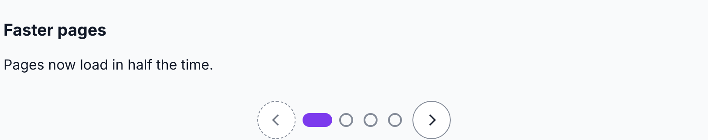
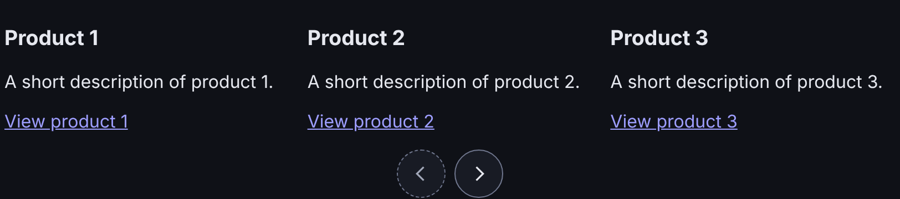
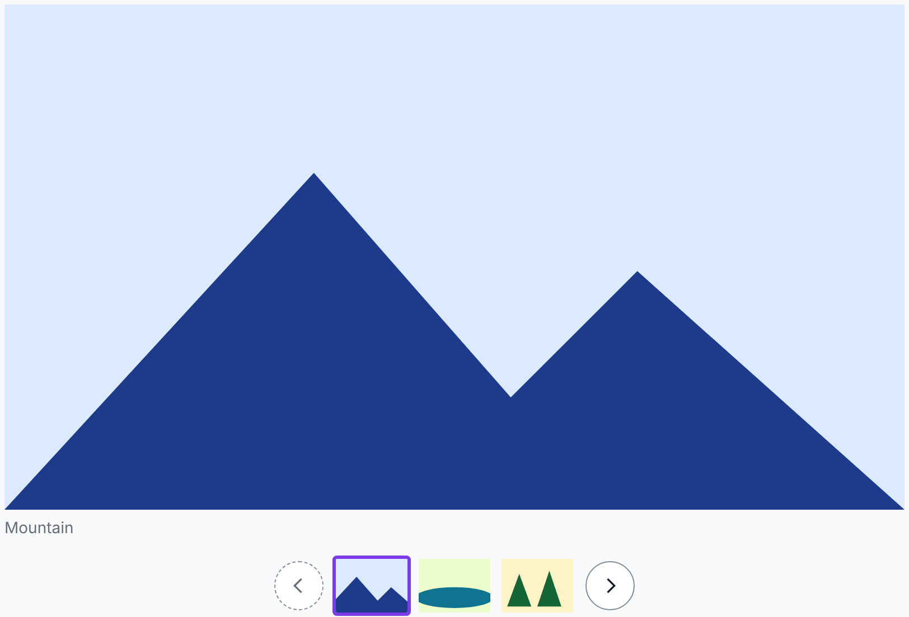

# autumn-plugin-carousel

An accessible carousel widget pack for [Autumn](https://github.com/autumn-foundation/autumn).

- All slides are in the server HTML. The carousel works with JavaScript off.
- It obeys the WAI-ARIA APG carousel pattern and WCAG 2.2 AA.
- It works under a strict CSP: no inline script, no `style` attribute.
- It uses the Autumn design tokens, so dark mode and density work.
- It works in right-to-left text and in forced colors.

| Slideshow (light) | Rail (dark) | Gallery with thumbnails |
|---|---|---|
|  |  |  |

Before you add a carousel, read [Use carousels with care](docs/research.md#1-use-carousels-with-care).
Use a carousel for product images, card rails and known content. Do not
use it for a home page hero.

## Install

Add the crate:

```toml
[dependencies]
autumn-plugin-carousel = { git = "https://github.com/autumn-foundation/autumn-plugin-carousel" }
```

Install the plugin:

```rust
use autumn_plugin_carousel::CarouselPlugin;

autumn_web::app()
    .plugin(CarouselPlugin::new())
    // ...
```

Link the assets in the layout, after the core widget assets:

```rust
head {
    link rel="stylesheet" href=(autumn_web::ui::WIDGETS_CSS_PATH);
    script src="/static/js/autumn-widgets.js" defer {}
    (autumn_plugin_carousel::head())
}
```

## Use

```rust
use autumn_plugin_carousel::{CarouselConfig, Slide, carousel};
use autumn_web::form::FieldOptions;
use maud::html;

let slides = [
    Slide::new(html! { h3 { "Fast" } p { "Pages load in 50 ms." } }),
    Slide::new(html! { h3 { "Safe" } p { "A strict CSP is the default." } }),
];
let markup = carousel(&slides, &CarouselConfig::new("tour", "Product tour"), &FieldOptions::new());
```

Give each carousel on a page a different id. An id has ASCII letters,
digits, `-` and `_`, with no `--`. Use `CarouselConfig::try_new` for an id
from data.

Do not put the word "carousel" in the label. The role name already gives
this word.

### Layouts

| Call | Result |
|---|---|
| `CarouselConfig::new(id, label)` | A slideshow: one slide in view. |
| `.rail(PerView::new(3))` | A rail: 3 cards in view on a wide screen, one card and a part of the next on a narrow screen. |

### Markers

| Call | Result |
|---|---|
| `.markers(Markers::Dots)` | One dot for each slide. The slideshow default. |
| `.markers(Markers::Numbers)` | One number for each slide. |
| `.markers(Markers::Thumbnails)` | One small image for each slide. Use it for product images. |
| `.markers(Markers::None)` | No markers. The rail default. |

### Images

```rust
Slide::image("/img/chair.jpg", "A red chair, front view", 800, 600)
    .caption(html! { "Front" })
    .thumbnail("/img/chair-small.jpg")
```

The start image loads immediately. The other images load lazily. Add
`.priority()` to the config when the carousel is the largest item at the
top of the page.

### Other settings

| Call | Effect |
|---|---|
| `.labelled_by("heading-id")` | Use a visible heading as the name. |
| `.start(2)` | Show slide 3 first. |
| `.rewind()` | At an end, previous and next go to the other end. |
| `.auto_rotate()` | Rotate every 6 s. |
| `.rotation_interval(Duration::from_secs(8))` | Rotate every 8 s. The range is 1 s to about 24.8 days. |
| `.text(CarouselText::new().previous("Zurück").next("Weiter"))` | Translate the text. |

Each `Slide` can have `.label("Spring sale")`. The label replaces the
"N of M" name. A number marker keeps its digit in the name.

## Automatic rotation

Rotation is off by default. When you turn it on:

- A rotation button is the first control.
- Focus in the carousel stops rotation. Focus on the rotation button does not.
- A click on previous, next or a marker stops rotation.
- A scroll of the track by the user stops rotation.
- Mouse hover pauses rotation.
- A hidden page pauses rotation.
- Reduced motion starts the carousel stopped.
- Rotation does not move focus. It does not speak.

After the user presses Start, focus in the carousel pauses rotation until
focus goes out. Hover does not pause it. Only the rotation button or a
slide move stops it.

## Keyboard

The pack adds no key bindings.

| Key | Effect |
|---|---|
| Tab | Moves to the rotation, previous, marker and next controls, then into the track. |
| Enter, Space | Activates the focused button or link. |
| Arrow keys on the track | The browser scrolls the track. In a slideshow, snap stops at each slide. In a rail, snap stops near a card. |

## Without JavaScript

- All slides show in a track that scrolls.
- The buttons stay hidden.
- Each marker is a link to its slide.
- `aria-current` stays on the start marker.

## Screen readers

- After a user move, a hidden live region speaks "2 of 4". A rail speaks
  the cards in view, for example "4 to 6 of 8".
- Rotation and a free scroll do not speak.
- When a slide that holds focus goes out of view, focus goes to the track.

## Events

The root sends `autumn-carousel:change` one time after each move, when the
scroll stops. `event.detail.index` is the new index, from 0.

```js
document.addEventListener('autumn-carousel:change', (e) => {
  console.log(e.target.id, e.detail.index);
});
```

## htmx

The pack sets up each carousel that htmx adds. It listens for
`autumn:init`. For a long rail, put the core `pagination` widget under the
carousel and swap the carousel.

## Styling

Change these properties on `.autumn-carousel-root` in your own stylesheet.
Load your stylesheet after `head()`, or use a more specific selector:

| Property | Default |
|---|---|
| `--autumn-carousel-gap` | `var(--space-4)` |
| `--autumn-carousel-control` | `2.75rem` |
| `--autumn-carousel-dot` | `0.75rem` |

## Development

```bash
cargo fmt --all
cargo clippy --all-targets --all-features -- -D warnings
cargo test
cargo test --features system-tests --test browser -- --ignored --test-threads=1
```

The browser tests need Chromium. Set `AUTUMN_CHROMIUM` to its path if the
tests do not find it.

## Documents

- [Research](docs/research.md)
- [Design and acceptance criteria](docs/design.md)
- [Acceptance evidence](docs/acceptance.md)

## License

Apache-2.0. See [LICENSE](LICENSE). The test copy of axe-core is MPL-2.0.
See [tests/fixtures/axe-core/LICENSE](tests/fixtures/axe-core/LICENSE).
